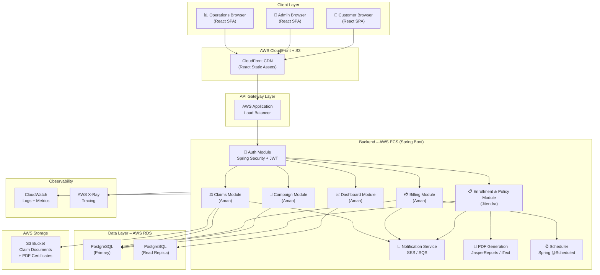
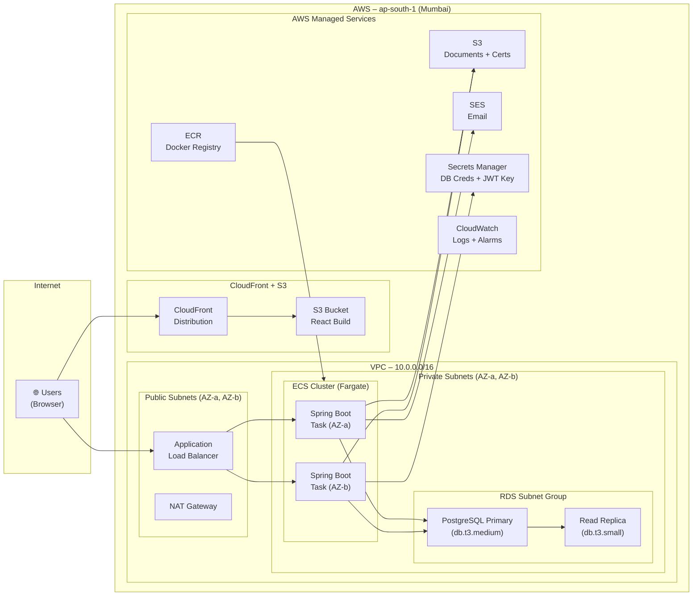
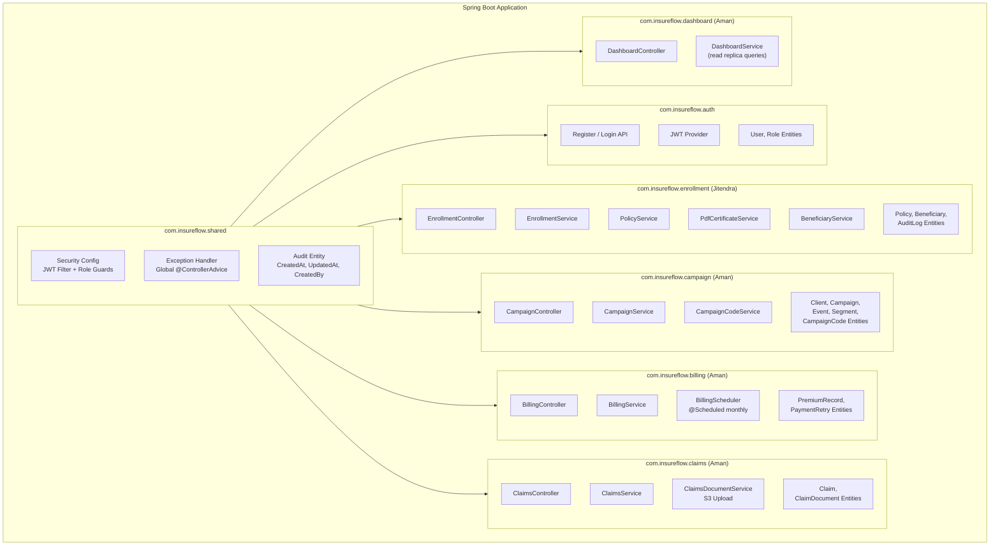
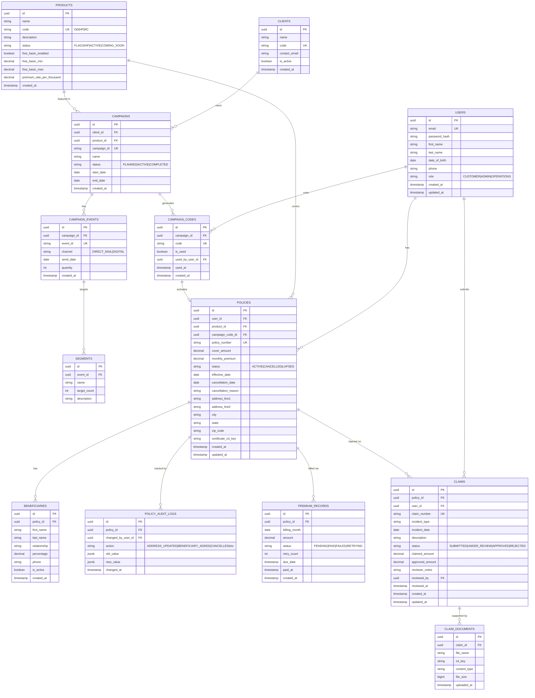
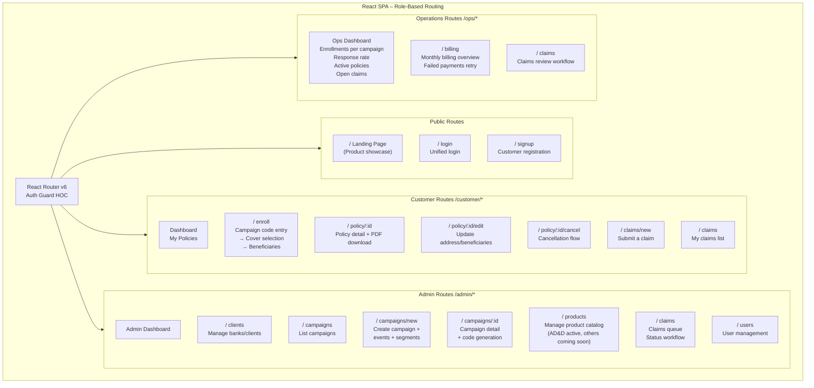
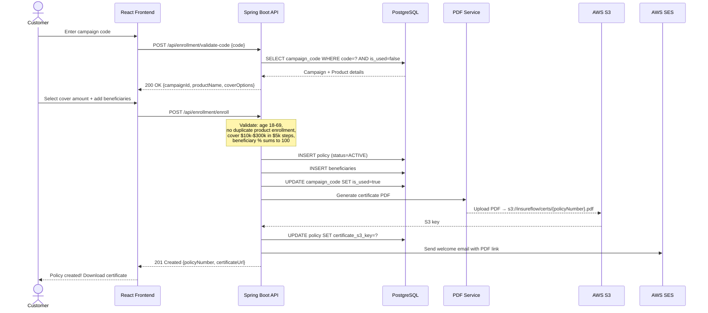
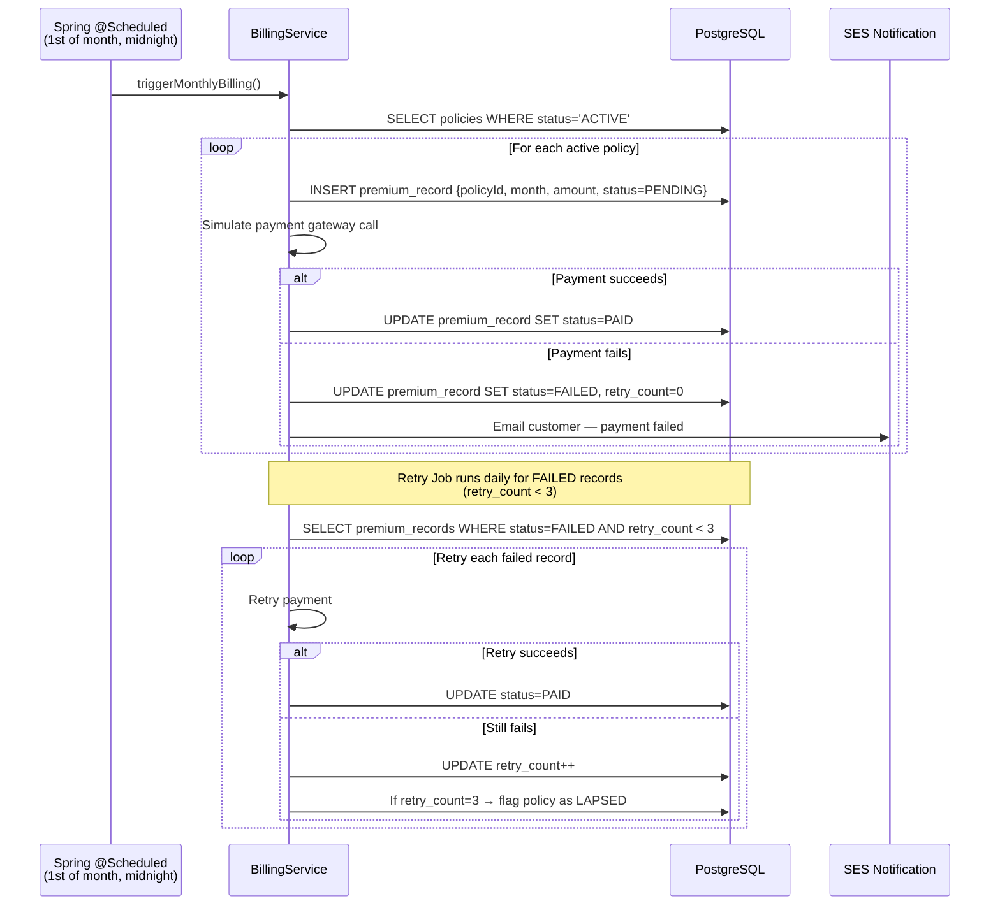
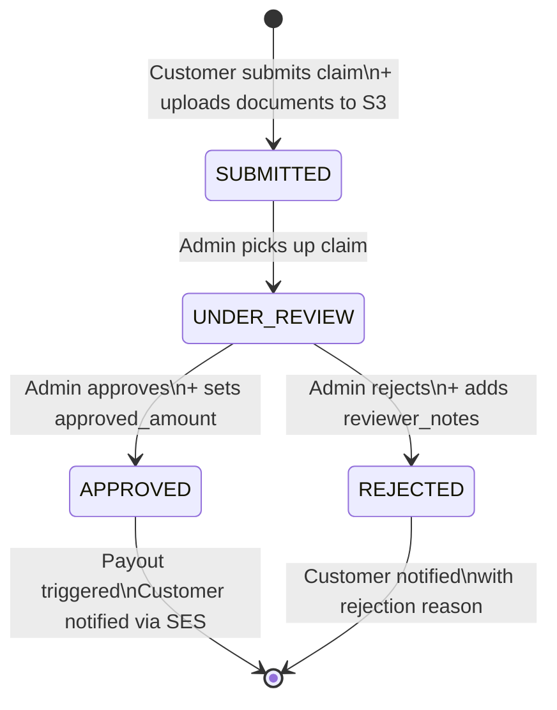
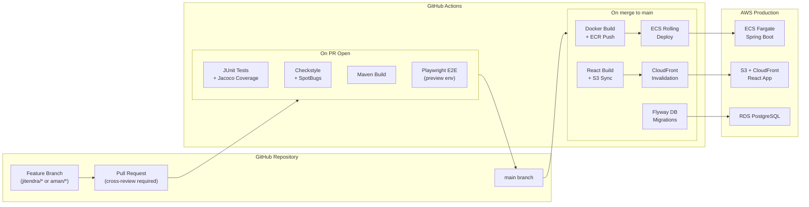

# InsureFlow – Architecture & Design Document
> **Prepared for:** Jitendra & Aman | **Deadline:** Friday, 27 November 2026 EOD
> **Role:** Enterprise Software Architect (15+ years)

---

## 1. Executive Summary

InsureFlow is a multi-tenant, role-based insurance enrollment and servicing platform. It connects a **bank (client)** that runs campaigns, **customers** who enroll in AD&D insurance products, and an **operations/admin team** that manages billing, claims, and campaign analytics.

The system is built on a **Spring Boot microservices-inspired monolith** (modular monolith pattern — pragmatic for a team of 2), React SPA frontend, PostgreSQL on RDS, and hosted fully on AWS.

---

## 2. High-Level System Architecture

---

## 3. AWS Infrastructure Architecture

---

## 4. Modular Monolith – Package Structure

---

## 5. Database ER Diagram

---

## 6. Frontend Application Structure

---

## 7. Enrollment Flow (Jitendra's Module)

---

## 8. Billing Flow (Aman's Module)

---

## 9. Claims Flow (Aman's Module)

---

## 10. CI/CD Pipeline

---

## 11. Security Architecture

| Layer | Mechanism |
|-------|-----------|
| **Authentication** | JWT Bearer tokens (15-min access + 7-day refresh) |
| **Authorization** | Spring Security `@PreAuthorize` with roles: `ROLE_CUSTOMER`, `ROLE_ADMIN`, `ROLE_OPERATIONS` |
| **Password** | BCrypt hashing (strength 12) |
| **Secrets** | AWS Secrets Manager (DB creds, JWT signing key, SES keys) |
| **Transport** | HTTPS enforced via CloudFront + ACM certificate |
| **S3 Documents** | Pre-signed URLs (15-min TTL) — no public bucket access |
| **API Rate Limiting** | AWS WAF on ALB |
| **CORS** | Restricted to CloudFront origin only |
| **SQL Injection** | JPA/Hibernate parameterized queries only |
| **Audit Trail** | Every policy change → `policy_audit_logs` with old/new JSON |

---

## 12. API Contract Summary (OpenAPI)

### Auth
| Method | Endpoint | Access | Description |
|--------|----------|--------|-------------|
| POST | `/api/auth/register` | Public | Customer self-registration |
| POST | `/api/auth/login` | Public | Login → JWT |
| POST | `/api/auth/refresh` | Public | Refresh token |

### Enrollment & Policy (Jitendra)
| Method | Endpoint | Access | Description |
|--------|----------|--------|-------------|
| POST | `/api/enrollment/validate-code` | Customer | Validate campaign code |
| POST | `/api/enrollment/enroll` | Customer | Enroll + create policy |
| GET | `/api/policies` | Customer | List my policies |
| GET | `/api/policies/{id}` | Customer | Policy detail |
| GET | `/api/policies/{id}/certificate` | Customer | Pre-signed PDF URL |
| PUT | `/api/policies/{id}/address` | Customer | Update address |
| PUT | `/api/policies/{id}/beneficiaries` | Customer | Update beneficiaries |
| DELETE | `/api/policies/{id}` | Customer | Cancel policy |
| GET | `/api/policies/{id}/audit` | Customer/Admin | Audit history |

### Campaign (Aman)
| Method | Endpoint | Access | Description |
|--------|----------|--------|-------------|
| POST | `/api/admin/clients` | Admin | Create client (bank) |
| GET | `/api/admin/clients` | Admin | List clients |
| POST | `/api/admin/campaigns` | Admin | Create campaign |
| POST | `/api/admin/campaigns/{id}/events` | Admin | Add event + segments |
| POST | `/api/admin/campaigns/{id}/generate-codes` | Admin | Generate campaign codes |
| GET | `/api/admin/campaigns/{id}/codes` | Admin | List codes + usage |

### Billing (Aman)
| Method | Endpoint | Access | Description |
|--------|----------|--------|-------------|
| GET | `/api/ops/billing` | Operations | List billing records |
| POST | `/api/ops/billing/run` | Operations | Trigger manual billing run |
| POST | `/api/ops/billing/{id}/retry` | Operations | Retry failed payment |

### Claims (Aman)
| Method | Endpoint | Access | Description |
|--------|----------|--------|-------------|
| POST | `/api/claims` | Customer | Submit claim |
| POST | `/api/claims/{id}/documents` | Customer | Upload document |
| GET | `/api/claims` | Customer/Admin/Ops | List claims (filtered by role) |
| GET | `/api/claims/{id}` | All | Claim detail |
| PUT | `/api/claims/{id}/status` | Admin/Ops | Move claim status |

### Dashboard (Aman)
| Method | Endpoint | Access | Description |
|--------|----------|--------|-------------|
| GET | `/api/ops/dashboard` | Operations | Enrollments, response rate, active policies, open claims |
| GET | `/api/ops/dashboard/campaigns/{id}` | Operations | Per-campaign metrics |

### Products (Admin)
| Method | Endpoint | Access | Description |
|--------|----------|--------|-------------|
| GET | `/api/products` | Public | List products (AD&D Flagship, others Coming Soon) |
| PUT | `/api/admin/products/{id}` | Admin | Update product status |

---

## 13. Business Rules Reference

| Rule | Detail |
|------|--------|
| **Age eligibility** | Customer must be 18–69 years old at enrollment |
| **Cover amounts** | \$10,000 to \$300,000 in steps of \$5,000 (59 options) |
| **Premium formula** | `monthly_premium = (cover_amount / 1000) × $0.60` |
| **Example** | \$100,000 cover → \$60.00/month |
| **Duplicate enrollment** | One active policy per product per customer |
| **Beneficiary rule** | All beneficiary percentages must sum to exactly 100% |
| **Campaign code** | Single-use; linked to exactly one campaign |
| **Policy lapse** | 3 consecutive failed payments → policy LAPSED |
| **Cancellation** | Immediate; no pro-rata refund (confirm with business) |

---

## 14. Technology Stack Summary

| Layer | Technology | Version |
|-------|-----------|---------|
| **Backend Framework** | Spring Boot | 3.2.x |
| **Language** | Java | 21 (LTS) |
| **ORM** | Spring Data JPA + Hibernate | 6.x |
| **DB Migrations** | Flyway | 10.x |
| **Security** | Spring Security + JJWT | 0.12.x |
| **PDF Generation** | iText 7 / JasperReports | Latest |
| **Scheduler** | Spring `@Scheduled` | Built-in |
| **API Docs** | SpringDoc OpenAPI (Swagger UI) | 2.x |
| **Testing (Unit)** | JUnit 5 + Mockito + AssertJ | Built-in |
| **Testing (E2E)** | Playwright (Java bindings) | 1.44.x |
| **Frontend** | React + TypeScript | 18.x / 5.x |
| **UI Library** | Tailwind CSS + shadcn/ui | Latest |
| **HTTP Client** | Axios + React Query | Latest |
| **Build** | Maven (backend) / Vite (frontend) | Latest |
| **Containerization** | Docker + AWS ECR | Latest |
| **Hosting** | AWS ECS Fargate + RDS + S3 + CloudFront | - |
| **CI/CD** | GitHub Actions | - |
| **Monitoring** | AWS CloudWatch + X-Ray | - |

---

## 15. Module Ownership Summary

| Feature | Owner | Priority |
|---------|-------|----------|
| Auth (JWT, roles, login/signup) | **Shared** | P0 |
| DB schema + Flyway migrations | **Shared** | P0 |
| Product catalog API | **Shared** (Jitendra leads) | P0 |
| Campaign code validation | **Jitendra** (consumes Aman's codes) | P0 |
| Enrollment + policy creation | **Jitendra** | P0 |
| PDF certificate generation | **Jitendra** | P1 |
| Policy update + audit history | **Jitendra** | P1 |
| Policy cancellation | **Jitendra** | P1 |
| Client + Campaign creation | **Aman** | P0 |
| Event + Segment management | **Aman** | P0 |
| Campaign code generation | **Aman** | P0 |
| Monthly billing scheduler | **Aman** | P1 |
| Failed payment retry | **Aman** | P1 |
| Claims submission + S3 upload | **Aman** | P1 |
| Claims status workflow | **Aman** | P1 |
| Operations dashboard | **Aman** | P2 |
| CI/CD pipeline | **Shared** | P1 |
| AWS setup + IaC | **Shared** | P1 |

---

> [!IMPORTANT]
> **Agree on the DB schema (Section 5) and API contracts (Section 12) before writing a single line of feature code.** This is the shared contract between Jitendra and Aman's modules.

> [!TIP]
> **Start here:** `1.` Auth module (shared) → `2.` DB schema + Flyway migrations (shared) → `3.` Jitendra: Product catalog + Campaign code validation → `4.` Aman: Campaign + Code generation → `5.` Both develop their modules in parallel.

> [!NOTE]
> The **modular monolith** pattern is intentionally chosen over microservices. It gives you clean module boundaries (easy to split later), simple deployment (one ECS task), and no inter-service networking complexity — pragmatic for a 2-person team with a fixed deadline.
